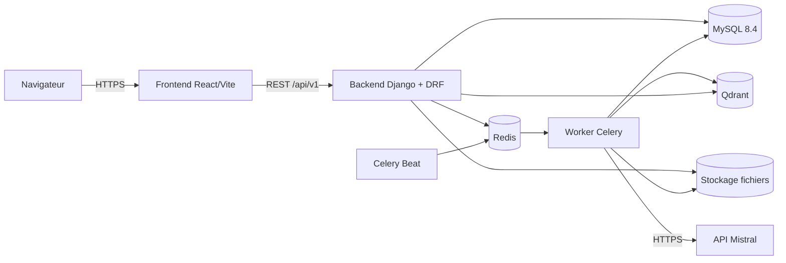

# Architecture — Nexus

## Vue d'ensemble



| Service    | Rôle                                                                 |
|------------|----------------------------------------------------------------------|
| `frontend` | SPA React + TypeScript (Vite)                                        |
| `backend`  | API REST Django + DRF (Gunicorn en production)                       |
| `worker`   | Tâches Celery : ingestion des documents, génération IA, envoi d'e-mails |
| `beat`     | Planification : rappels d'échéances                                  |
| `db`       | MySQL 8.4 — source de vérité                                         |
| `redis`    | Broker Celery + cache                                                |
| `qdrant`   | Vecteurs des chunks de documents (RAG)                               |

## Arborescence du dépôt

```
nexus/
├── backend/
├── frontend/
├── docs/
│   ├── ADR.md
│   ├── ARCHITECTURE.md
│   ├── DATABASE.md
│   └── API.md
├── docker-compose.yml
├── .env.example
└── README.md
```

## Backend — une app Django par domaine

```
backend/
├── config/
│   ├── settings/
│   │   ├── base.py          # common settings
│   │   ├── dev.py
│   │   └── prod.py
│   ├── urls.py              # /api/v1/ router + schema
│   ├── celery.py
│   ├── asgi.py
│   └── wsgi.py
├── apps/
│   ├── core/                # base models, pagination, exception handler, permissions, storage
│   ├── accounts/            # custom User, auth (JWT), profile, account deletion
│   ├── billing/             # Plan, Subscription, quota services
│   ├── subjects/            # Subject ("casiers" per course)
│   ├── documents/           # Document, Chunk, upload/ingestion pipeline
│   ├── revision/            # RevisionSheet (fiches), PDF export
│   ├── quizzes/             # Quiz, Question, Choice, Attempt
│   ├── planning/            # Event (exams, homework), Reminder
│   ├── assistant/           # Conversation, Message (Q&A on documents)
│   ├── ai/                  # AIJob, AIProvider abstraction, prompts, RAG
│   ├── notifications/       # in-app notifications, e-mail sending
│   └── progress/            # read-only stats (no models, aggregates)
├── templates/               # PDF + e-mail templates
├── requirements/
│   ├── base.txt
│   ├── dev.txt
│   └── prod.txt
├── manage.py
└── Dockerfile
```

Structure type d'une app :

```
apps/<domain>/
├── models.py
├── serializers.py
├── views.py          # thin: validation + call to services
├── services.py       # business logic (quota checks, job creation…)
├── selectors.py      # read queries (always filtered by owner)
├── permissions.py
├── tasks.py          # Celery tasks
├── urls.py
├── admin.py
└── tests/
```

**Règles.**
- Les vues restent fines : la logique métier va dans `services.py`. Elle devient ainsi testable sans passer par HTTP.
- Une app ne lit pas directement les modèles d'une autre app pour y écrire : elle passe par le service de cette app. Exemple : `revision` appelle `ai.services.create_job()`.
- `apps/ai` est le seul module qui parle au fournisseur IA.

## Frontend — organisation par feature

```
frontend/
├── src/
│   ├── app/                 # router, providers (QueryClient, Auth), layout
│   ├── features/
│   │   ├── auth/
│   │   ├── subjects/
│   │   ├── documents/
│   │   ├── revision/
│   │   ├── quizzes/
│   │   ├── planning/
│   │   ├── assistant/
│   │   ├── progress/
│   │   └── account/         # profile, plan, usage, account deletion
│   ├── shared/
│   │   ├── api/             # axios client, JWT interceptor, error parsing
│   │   ├── components/      # design-system UI components
│   │   ├── hooks/
│   │   └── utils/
│   ├── styles/
│   └── main.tsx
├── index.html
├── vite.config.ts
├── tsconfig.json
└── Dockerfile
```

Structure type d'une feature :

```
features/<feature>/
├── api.ts            # typed calls to the API
├── hooks.ts          # TanStack Query hooks (useSubjects, useCreateSubject…)
├── types.ts
├── components/
└── pages/
```

**Choix front.**
- **TanStack Query** pour l'état serveur (cache, invalidation, polling des `AIJob`) : pas de Redux nécessaire.
- **React Router** pour le routage.
- Types API générés à partir du schéma OpenAPI (`openapi-typescript`) : le front et le back partagent le même contrat.
