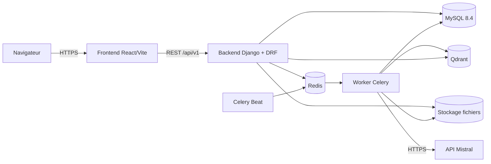

# Architecture — Nexus

## Vue d'ensemble



| Service    | Rôle                                                                 |
|------------|----------------------------------------------------------------------|
| `frontend` | SPA React + TypeScript (Vite)                                        |
| `backend`  | API REST Django + DRF (Gunicorn en production)                       |
| `worker`   | Tâches Celery : ingestion des documents, génération IA, envoi d'e-mails |
| `beat`     | Planification : rappels d'échéances                                  |
| `db`       | MySQL 8.4 — source de vérité                                         |
| `redis`    | Broker Celery + cache                                                |
| `qdrant`   | Vecteurs des chunks de documents (RAG)                               |

## Arborescence du dépôt

```
nexus/
├── backend/
├── frontend/
├── docs/
│   ├── ADR.md
│   ├── ARCHITECTURE.md
│   ├── DATABASE.md
│   └── API.md
├── docker-compose.yml
├── .env.example
└── README.md
```

## Backend — une app Django par domaine

```
backend/
├── config/
│   ├── settings/
│   │   ├── base.py          # common settings
│   │   ├── dev.py
│   │   └── prod.py
│   ├── urls.py              # /api/v1/ router + schema
│   ├── celery.py
│   ├── asgi.py
│   └── wsgi.py
├── apps/
│   ├── core/                # base models, pagination, exception handler, permissions, storage
│   ├── accounts/            # custom User, auth (JWT), profile, account deletion
│   ├── billing/             # Plan, Subscription, quota services
│   ├── subjects/            # Subject ("casiers" per course)
│   ├── documents/           # Document, Chunk, upload/ingestion pipeline
│   ├── revision/            # RevisionSheet (fiches), PDF export
│   ├── quizzes/             # Quiz, Question, Choice, Attempt
│   ├── planning/            # Event (exams, homework), Reminder
│   ├── assistant/           # Conversation, Message (Q&A on documents)
│   ├── ai/                  # AIJob, AIProvider abstraction, prompts, RAG
│   ├── notifications/       # in-app notifications, e-mail sending
│   └── progress/            # read-only stats (no models, aggregates)
├── templates/               # PDF + e-mail templates
├── requirements/
│   ├── base.txt
│   ├── dev.txt
│   └── prod.txt
├── manage.py
└── Dockerfile
```

Structure type d'une app :

```
apps/<domain>/
├── models.py
├── serializers.py
├── views.py          # thin: validation + call to services
├── services.py       # business logic (quota checks, job creation…)
├── selectors.py      # read queries (always filtered by owner)
├── permissions.py
├── tasks.py          # Celery tasks
├── urls.py
├── admin.py
└── tests/
```

**Règles.**
- Les vues restent fines : la logique métier va dans `services.py`. Elle devient ainsi testable sans passer par HTTP.
- Une app ne lit pas directement les modèles d'une autre app pour y écrire : elle passe par le service de cette app. Exemple : `revision` appelle `ai.services.create_job()`.
- `apps/ai` est le seul module qui parle au fournisseur IA.
- `apps/core/demo/` : données de démo (`data.py`), générateur de PDF minimal (`pdf.py`)
  et création idempotente (`seed.py`), utilisés par la commande `seed_demo` (ADR-020).

### Front-end : organisation

    frontend/src/
    ├── app/
    │   ├── navigation.ts        # navigation decrite une fois (sidebar, barre mobile, routes)
    │   ├── router.tsx           # routes (+ /design en developpement)
    │   ├── layouts/             # RootLayout, Sidebar, BottomNav
    │   └── pages/               # pages d'assemblage
    ├── features/                # une fonctionnalite par dossier (health pour l'instant)
    ├── shared/
    │   ├── a11y/contrast.ts     # calcul du contraste WCAG
    │   ├── api/                 # client API unique
    │   ├── lib/cx.ts            # assemblage de classes
    │   ├── theme/               # preference de theme (contexte, hook, selecteur)
    │   └── ui/                  # Button, Input, Modal, PageHeader, toast/
    ├── styles/
    │   ├── tokens.css           # tokens de design (light-dark + @theme)
    │   ├── tokens.test.ts       # contraste AA des tokens
    │   └── base.css             # styles de base, focus visible, animations reduites
    └── test/                    # setup, rendu de l'application, audit axe

Le design system est visible en développement sur `/design`.

Structure type d'une feature :

```
features/<feature>/
├── api.ts            # typed calls to the API
├── hooks.ts          # TanStack Query hooks (useSubjects, useCreateSubject…)
├── types.ts
├── components/
└── pages/
```

**Choix front.**
- **TanStack Query** pour l'état serveur (cache, invalidation, polling des `AIJob`) : pas de Redux nécessaire.
- **React Router** pour le routage.
- Types API générés à partir du schéma OpenAPI (`openapi-typescript`) : le front et le back partagent le même contrat.
- `features/auth/config.ts` : page d'arrivée après connexion (`HOME_AFTER_LOGIN`) et
  interrupteur de l'onboarding (`ONBOARDING_ENABLED`).
- `app/query-client.ts` : `createQueryClient()`, utilisé à la fois par l'application et par
  les tests, pour que les tests vérifient la configuration réelle du cache.


## Casiers et cours (S7)

### Back

| Application | Fichiers | Rôle |
| --- | --- | --- |
| `subjects` | `icons.py`, `colors.py` | Listes fermées des icônes et des couleurs |
| `subjects` | `selectors.py` | `lockers_for(user)`, `get_locker(user, pk)` : toute lecture part du propriétaire |
| `subjects` | `services.py` | `create_locker` : position en fin de liste, unicité garantie par la base |
| `documents` | `validators.py` | Signature PDF, empreinte SHA-256, format des tailles |
| `documents` | `services.py` | `upload_course` : création du cours, nettoyage du fichier en cas d'échec |
| `documents` | `selectors.py` | `courses_in(locker)`, `get_course(user, pk)` |
| `billing` | `selectors.py` | `max_upload_size_for(user)` : limite de l'offre |

Les routes sont branchées dans `config/api_urls.py`, sous `/api/v1/` :

- `lockers/` → `apps.subjects.urls` (espace de noms `lockers`)
- `courses/` → `apps.documents.urls` (espace de noms `courses`)

Les tests utilisent `reverse()` avec ces espaces de noms. Ils ne dépendent donc pas du préfixe, ce qui impose une vérification manuelle ou un test de bout en bout pour valider le branchement réel.

### Front

| Dossier `features/lockers/` | Rôle |
| --- | --- |
| `api.ts` | Schémas zod (snake_case → camelCase), appels à l'API |
| `hooks.ts` | `useLockers`, `useLocker`, `useLockerChoices`, `useCreateLocker`, `useCourses`, `useUploadCourse` |
| `icons.tsx` | Correspondance entre noms d'icônes et composants lucide, avec repli sur le dossier |
| `format.ts` | Nombre de cours, taille, date, état d'analyse en toutes lettres |
| `components/` | `LockerBadge`, `LockerCard`, `ChoiceRadioGroup`, `CourseUploader`, `CourseList` |
| `pages/` | `LockersPage`, `NewLockerPage`, `LockerPage` |

Routes (protégées par `RequireAuth`, sous `RootLayout`) :

| Route | Page |
| --- | --- |
| `/casiers` | Liste des casiers |
| `/casiers/nouveau` | Création d'un casier |
| `/casiers/:lockerId` | Page d'un casier |

Les clés de cache commencent toutes par `["lockers"]`. Une création ou un dépôt invalide tout ce préfixe, ce qui met à jour la liste, les compteurs et les cours. La déconnexion vide tout le cache (`queryClient.clear()`), donc un élève ne voit jamais les casiers du précédent sur le même ordinateur.

Le client d'API (`shared/api/client.ts`) envoie un `FormData` tel quel : le navigateur écrit lui-même l'en-tête `multipart` et sa frontière.


## Fiches de révision (S8)

### Back : application `revision`

| Fichier | Rôle |
| --- | --- |
| `sanitizer.py` | `sanitize_sheet_html` : liste blanche `nh3` |
| `models.py` | `RevisionSheet.save()` nettoie toujours le contenu |
| `selectors.py` | `sheets_in(locker)`, `get_sheet(user, pk)` filtré sur `owner` et `subject__owner` |
| `services.py` | `create_sheet` (propriétaire = celui du casier), `update_sheet` (`update_fields`), `delete_sheet` |
| `serializers.py` | Résumé (liste), détail, écriture (`title`, `content` uniquement) |
| `views.py` | `LockerSheetsView`, `SheetDetailView` |

Routes : `lockers/<id>/sheets/` dans `apps/subjects/urls.py` (espace de noms `lockers`), et `sheets/` dans `config/api_urls.py` vers `apps/revision/urls.py` (espace de noms `sheets`).

### Front : `features/sheets/`

| Élément | Rôle |
| --- | --- |
| `api.ts`, `hooks.ts` | Schémas zod, requêtes et mutations ; clés de cache sous `["sheets"]` |
| `paths.ts` | URL des pages de fiches, en un seul endroit |
| `safe-html.ts` | Deuxième nettoyage (DOMPurify), même liste que le serveur |
| `sheet-content.css` | Mise en forme du contenu, dans l'éditeur et à la lecture |
| `components/` | `LockerSheets`, `EditorToolbar`, `SheetForm`, `SheetNotFound` |
| `pages/` | `NewSheetPage`, `EditSheetPage`, `SheetPage` |

| Route | Page |
| --- | --- |
| `/casiers/:lockerId/fiches/nouvelle` | Création |
| `/fiches/:sheetId` | Lecture et suppression |
| `/fiches/:sheetId/modifier` | Modification |

Dans les tests, `src/test/setup.ts` remplace les mesures de mise en page dont ProseMirror a besoin et que jsdom ne calcule pas (`getClientRects`, `elementFromPoint`).
