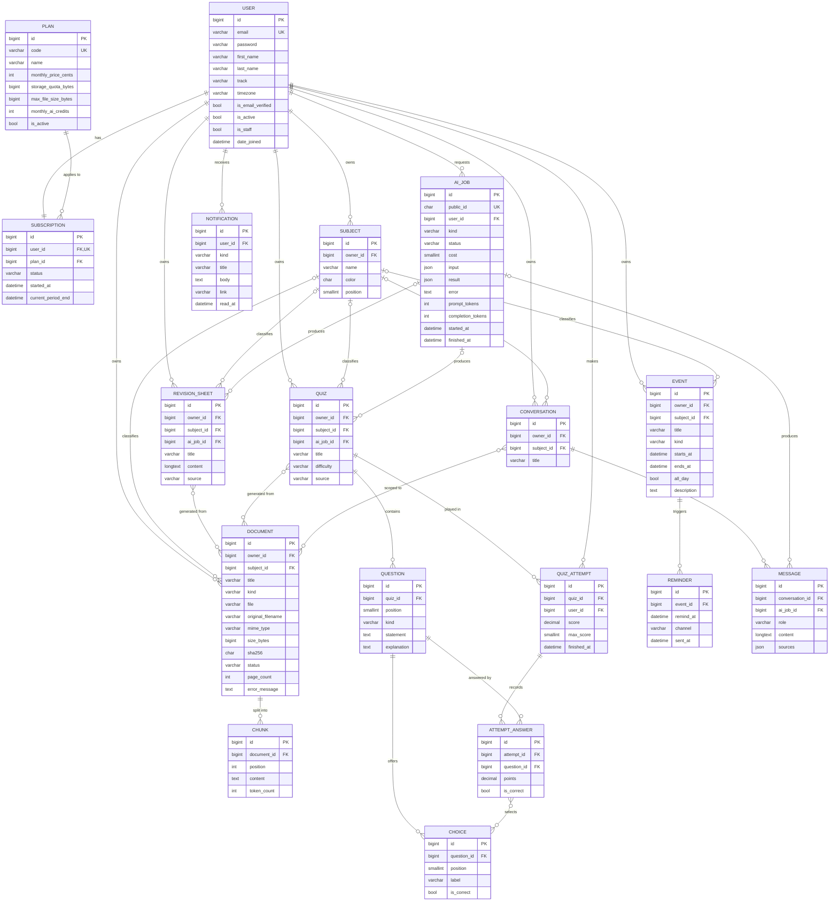

# Base de données — Nexus

MySQL 8.4 · InnoDB · `utf8mb4` / `utf8mb4_0900_ai_ci` · dates en UTC.
Toutes les clés primaires sont des `BIGINT` auto-incrémentés (`DEFAULT_AUTO_FIELD = BigAutoField`).

## Diagramme entité-relation

Toutes les tables métier ont aussi `created_at` et `updated_at` (via un modèle abstrait `TimeStampedModel`). Ces colonnes ne figurent pas dans le diagramme pour le garder lisible.

## Détail des tables

### `accounts_user`
| Colonne | Type | Contraintes |
|---|---|---|
| email | VARCHAR(254) | UNIQUE, NOT NULL, identifiant de connexion |
| track | VARCHAR(50) | NULL — filière (ex. « ECG ») |
| timezone | VARCHAR(64) | défaut `Europe/Paris` |
| is_email_verified | BOOL | défaut `false` |

### `billing_plan` / `billing_subscription`
- `plan.code` UNIQUE (`basic`, `intermediate`, `premium`) ; tarifs en **centimes** (entier, jamais de float pour de l'argent).
- `subscription.user_id` UNIQUE : une souscription par utilisateur, créée automatiquement à l'inscription sur l'offre `basic`.
- `subscription.plan_id` en **PROTECT** : impossible de supprimer une offre encore utilisée.
- `status` ∈ `active`, `canceled`, `expired`.

### `subjects_subject` (casiers)
- `UNIQUE (owner_id, name)` : pas deux matières du même nom pour un utilisateur.
- `color` CHAR(7) au format `#RRGGBB`, validé par `RegexValidator`.
- Index `(owner_id, position)` pour l'ordre d'affichage.

### `documents_document`
- `kind` ∈ `course`, `report_card`, `other`.
- `status` ∈ `pending`, `processing`, `ready`, `failed` (pipeline d'ingestion).
- `subject_id` NULL : un bulletin n'appartient pas à une matière.
- `owner_id` reste obligatoire même quand une matière est renseignée : c'est lui qui sert au filtrage de sécurité et au calcul du quota de stockage.
- Index : `(owner_id, subject_id)`, `(owner_id, created_at)`, `(owner_id, sha256)`.

### `documents_chunk`
- `UNIQUE (document_id, position)`.
- L'`id` du chunk sert d'identifiant au point Qdrant : on peut ainsi citer les sources d'une réponse et reconstruire l'index vectoriel.

### `revision_sheet` + `revision_sheet_documents` (M2M)
- `content` en Markdown (LONGTEXT).
- `source` ∈ `manual`, `ai`.

### `quizzes_*`
- `UNIQUE (quiz_id, position)` sur `question` ; `UNIQUE (question_id, position)` sur `choice`.
- `question.kind` ∈ `single` (réponse unique), `multiple` (choix multiples). Un même QCM peut mélanger les deux types.
- Règles de cohérence, vérifiées dans le service car elles portent sur plusieurs lignes (impossible avec une contrainte SQL simple) :
  - toute question a au moins 2 choix ;
  - `single` : exactement 1 choix correct ;
  - `multiple` : au moins 1 choix correct et au moins 1 choix incorrect.
- `attempt_answer` : `UNIQUE (attempt_id, question_id)`.
- `attempt_answer_selected_choices` (M2M `attempt_answer` ↔ `choice`) : choix cochés par l'utilisateur, aucun si la question est sautée. Le service vérifie que chaque choix appartient bien à la question, et qu'une question `single` n'a qu'un seul choix sélectionné.
- **Notation** : `attempt_answer.points` DECIMAL(5,2) et `quiz_attempt.score` DECIMAL(6,2). Pour le MVP, la notation est en tout-ou-rien : 1 point si la sélection correspond exactement aux bonnes réponses, 0 sinon. Le type décimal permettra d'introduire plus tard une notation partielle pour les choix multiples **sans migration**.
- Les `points` et `is_correct` sont figés au moment de la tentative : l'historique des scores reste juste même si le QCM est modifié ensuite.
- `quiz_attempt` : index `(user_id, finished_at)` pour les statistiques de progression.
- `CHECK (score <= max_score)`.

### `planning_event` / `planning_reminder`
- `kind` ∈ `exam`, `test`, `homework`, `other`.
- `CHECK (ends_at IS NULL OR ends_at >= starts_at)`.
- Index `(owner_id, starts_at)` pour l'affichage du calendrier sur une période.
- `reminder` : `UNIQUE (event_id, remind_at, channel)` ; index `(sent_at, remind_at)` pour la tâche Beat qui recherche les rappels à envoyer.

### `assistant_conversation` / `assistant_message`
- `role` ∈ `user`, `assistant`.
- `sources` (JSON) : liste des `chunk_id` cités dans la réponse.
- Index `(conversation_id, created_at)`.

### `ai_job`
- `public_id` (UUID) exposé dans l'API pour le polling, plutôt que l'id séquentiel.
- `kind` ∈ `sheet_generation`, `quiz_generation`, `chat_answer`, `document_ingestion`.
- `status` ∈ `queued`, `running`, `succeeded`, `failed`.
- `cost` : nombre de crédits consommés (0 pour l'ingestion).
- Index `(user_id, created_at)` pour le calcul de la consommation mensuelle.

### `notifications_notification`
- Index `(user_id, read_at)` pour le compteur de notifications non lues.

## Règles de suppression

| Relation | `on_delete` | Raison |
|---|---|---|
| Toute FK → `user` | CASCADE | Droit à l'effacement (RGPD) |
| `subscription.plan` | PROTECT | Ne pas casser les abonnements existants |
| `*.subject` | SET_NULL | Supprimer un casier ne détruit jamais de contenu |
| `chunk.document` | CASCADE | Un chunk n'a pas de sens sans son document |
| `question.quiz`, `choice.question` | CASCADE | Composition |
| `attempt.quiz`, `attempt_answer.*` | CASCADE | L'historique suit le QCM |
| M2M `attempt_answer` ↔ `choice` | CASCADE sur la table de liaison | Un choix supprimé disparaît de la sélection ; les points déjà figés sont conservés |
| `reminder.event` | CASCADE | Composition |
| `message.conversation` | CASCADE | Composition |
| `*.ai_job` | SET_NULL | Le contenu généré survit à la purge des jobs |
| M2M → `document` | CASCADE sur la table de liaison uniquement | La fiche ou le QCM reste, seul le lien disparaît |

**Effets hors base**, déclenchés par un signal `post_delete` puis `transaction.on_commit` : suppression du fichier dans le stockage et des points Qdrant du document.
